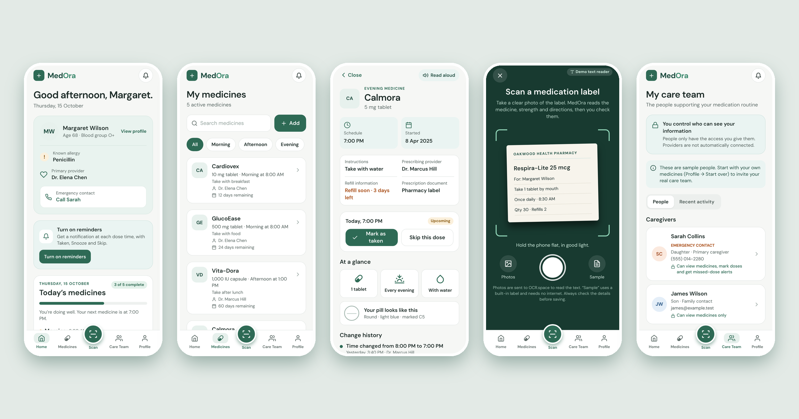

# MedOra

**A medication app for older adults and the family members who help them.**

MedOra keeps one shared routine for a patient, their caregivers and their care team. You can see what to take today, get reminders that actually ring, scan a pill-bottle label instead of typing it, and let a caregiver follow along live. The patient decides exactly what each person can see.



> All people and medicines in the sample data are fictional. MedOra is a student project, not a medical device, and it does not give medical advice.

## What works

| | |
|---|---|
| **Today’s medicines** | Doses grouped by morning, afternoon and evening. Tick one off or skip it with a reason. Due, missed and skipped doses are shown clearly. |
| **Real reminders** | Phone notifications at each dose time with **Taken**, **Snooze 10 min** and **Skip** buttons, plus a “Did you take it?” follow-up 30 minutes later. They work even when the app is closed. |
| **Label scanning** | Photograph a pharmacy label. MedOra reads the text and fills in the name, strength, dose, schedule, food rule, prescriber and quantity. You check everything before it saves. |
| **Safety checks** | New medicines are checked against your allergies, for example amoxicillin against a penicillin allergy. A pill countdown warns you a week before a refill is due. |
| **Change history** | Every change to a medicine records who made it and when. Dose and instructions are flagged as prescriber-only changes. |
| **Caregiver sharing** | Create a care circle and send a 6-letter invite code. A caregiver joins on their own phone and sees today’s doses live. With permission, they can mark a dose or send a reminder. |
| **Export** | A PDF medication summary (medicines, 30-day history, allergies, contacts) shared through the phone’s share menu. |
| **Accessibility** | Larger text, a simplified one-card home screen, and read-aloud in English, Spanish and Chinese. |
| **Sample mode** | “Explore with sample information” loads Margaret Wilson’s routine, so the app can be demoed without real data. |

## How it’s built

- **Stack:** [Expo](https://expo.dev) SDK 57, React Native, TypeScript and Expo Router.
- **Local first:** medicines, doses and the profile are stored on the phone with Zustand and AsyncStorage. The app works fully offline. Shared changes wait in an outbox and sync when the phone is back online.
- **Reminders:** `expo-notifications` daily triggers with an action category (Taken / Snooze / Skip). Follow-ups are scheduled on a rolling two-day window, kept under iOS’s 64-notification limit.
- **Scanning:** `expo-image-picker` captures the photo, `expo-image-manipulator` resizes it, and the [OCR.space](https://ocr.space/ocrapi) API reads the text. A rule-based parser ([`src/lib/parseLabel.ts`](src/lib/parseLabel.ts)) turns that text into fields and has its own tests.
- **Sharing:** [Supabase](https://supabase.com) Postgres with row-level security, so caregivers only read and write what the patient allows. A `join_circle` function handles invite codes, and realtime subscriptions push live updates. The schema is in [`supabase/schema.sql`](supabase/schema.sql).
- **Export and speech:** `expo-print` and `expo-sharing` make the PDF; `expo-speech` reads aloud.

```
src/app/         screens (Expo Router): tabs, medicine detail, forms, sharing
src/components/  shared UI in the team’s design system
src/lib/         store, schedule math, reminders, scanning, sync, PDF, speech
supabase/        database schema and security rules
scripts/         parser and allergy-check tests
```

## Try it

See **[SETUP.md](SETUP.md)**. In short: install Node.js and run `npm install` and `npx expo start`, then scan the QR code with the **Expo Go** app on your phone.

Checks: `npm run typecheck` · `npm run lint` · `npm run test:parser`

## Background

MedOra started as a team project for CE596. Our research and performance map compared Medisafe, Dosecast and the CVS Pharmacy app. They already handle tracking and reminders well, so MedOra aims to stand out on **care coordination**, **accessibility and understanding**, and **data privacy**. The visual design follows the team’s Figma Make prototype.

**Team:** Sriya, Kai, Sneha, Oulaiphone

### My role
<!-- Edit this so it describes exactly what you did. -->
I worked on [research / the performance map / …], presented the product roadmap, and turned the team’s clickable prototype into this working app, using Claude (an AI assistant) as a coding partner.

## Limitations and next steps

- **Caregiver alerts when the app is closed:** a caregiver sees missed doses live in their app, but a push alert to their phone needs a server job and an installed build.
- **Scanning privacy:** label photos are sent to OCR.space. On-device text recognition would keep them on the phone.
- **Allergy check depth:** it matches names and drug families. It is not a full interaction database.
- **Refills:** refill requests to a pharmacy are not connected.
